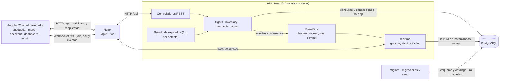
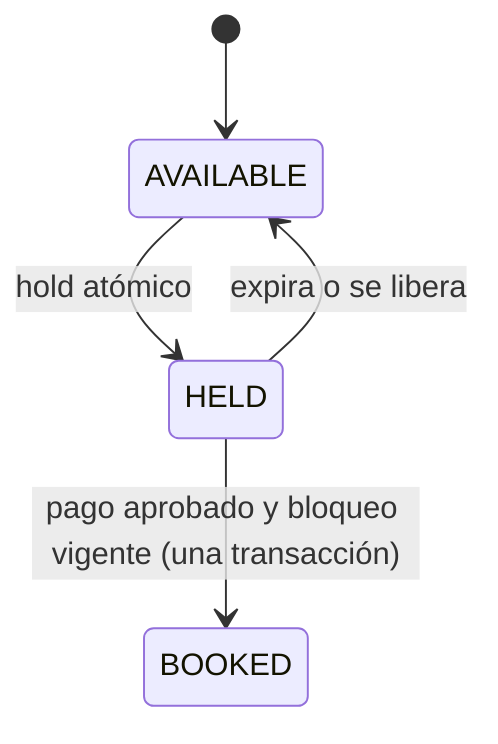
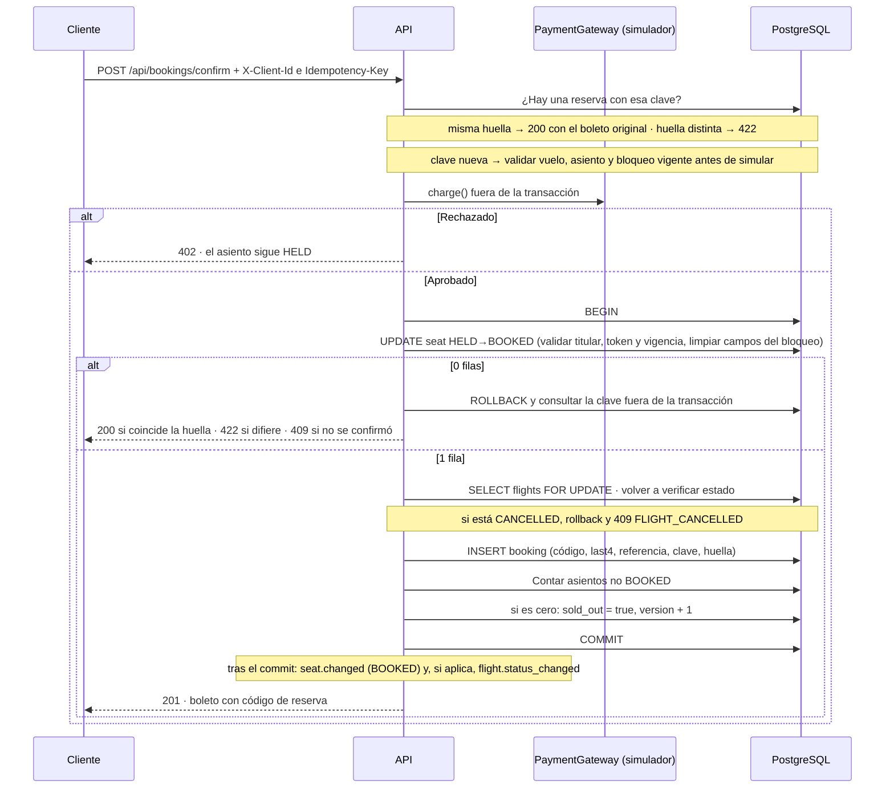

# Arquitectura · Sistema de reservas de vuelos en tiempo real

> Documento obligatorio del enunciado (sección 6.2): diseño, justificación, concurrencia, decisiones técnicas y ejecución.
> **Estado:** HU1–HU4 están integradas en `develop` con Angular, la API y PostgreSQL. La [trazabilidad de requisitos](handoff/checklist.md#trazabilidad-de-la-entrega-m5) enlaza la implementación, las pruebas y las limitaciones de la entrega.
>
> Documentos complementarios: [reglas de negocio](handoff/business-rules.md), [contratos entre frontend y backend](handoff/contracts-and-open-questions.md) y [persistencia y migraciones](handoff/persistence.md).

---

## 1. Visión general

| Pieza | Tecnología | Rol |
| --- | --- | --- |
| Frontend | Angular 21 (standalone, signals, zoneless) servido por Nginx | Una sola aplicación: área pública y área de administración en carga diferida |
| API | NestJS 11 sobre Node.js 24 (desde 24.11), TypeScript 5.9 | Una sola API: búsqueda, bloqueo, confirmación, pago simulado, barrido de expirados, administración de vuelos; REST y un *gateway* Socket.IO |
| Tiempo real | Socket.IO con salas (`flight:{id}`, `search`) | Difusión de eventos del servidor a los clientes |
| Persistencia | PostgreSQL 17 con TypeORM 1.1.3 | Única fuente de verdad: atomicidad, restricciones y reloj |
| Contratos | `packages/shared` (TypeScript) | DTOs, enums de estado y contrato tipado de eventos |
| Ejecución | Docker Compose | Base de datos, migraciones, API y frontend con un solo comando |

---

## 2. Diagrama de arquitectura



**Patrón de comunicación.** REST atiende las búsquedas y los comandos de negocio con respuestas y errores HTTP. En Socket.IO, el cliente envía `join`, el servidor responde con un *ack* y luego difunde cambios a las salas suscritas. Nginx sirve Angular y encamina ambos protocolos bajo el mismo origen.

---

## 3. Justificación de la arquitectura

### 3.1. Estilo: monolito modular, una sola aplicación

| Opción | Decisión | Razón |
| --- | --- | --- |
| **Monolito modular, una aplicación** | ✅ Adoptado | Un dominio, una base de datos, un proceso. La consistencia del asiento exige una única fuente de verdad transaccional. |
| Dos aplicaciones por audiencia (pública y administración) | ⏸️ Evolución | Ninguna historia lo exige y obliga a crear un canal de eventos entre procesos (§10). |
| Microservicios | ❌ | Un bloqueo atómico distribuido es más difícil de garantizar y la infraestructura no aporta a lo evaluado. |
| Serverless | ❌ | Conexiones WebSocket persistentes y temporizadores de expiración encajan mal con funciones efímeras. |

**Hexagonal donde hay una costura real, no en todas partes.** Se definen puertos solo donde existe (o existirá) una segunda implementación: `PaymentGateway` (simulador hoy, proveedor real mañana) y `EventBus` (bus en proceso hoy, Redis o `LISTEN/NOTIFY` mañana). Las reglas del asiento viven en SQL atómico y en funciones puras de transición; no se envuelven en repositorios abstractos adicionales.

### 3.2. Cómo cubre la API las historias de usuario

| Historia | Exige | Resolución |
| --- | --- | --- |
| HU1 · Búsqueda | Que un cambio de estado llegue a la lista sin recargar | `flight.status_changed` a la sala `search`. Cambios: `DELAYED`, `CANCELLED` (administración) y `soldOut` (automático al agotarse, §4.4). |
| HU2 · Bloqueo | Que nadie más tome el asiento y que todos lo vean bloqueado | `UPDATE` condicional atómico; tras el *commit*, `seat.changed` (`HELD`) a `flight:{id}`. |
| HU3 · Confirmación | Pago ficticio, sin *double booking*, asiento deshabilitado para todos los que consultan ese vuelo | Pago simulado y una sola transacción `HELD → BOOKED` + reserva, con `UNIQUE`. Tras el *commit*, `seat.changed` (`BOOKED`) a todos los clientes de `flight:{id}`. Quien entre después recibe el estado en la instantánea. |
| HU4 · Dashboard | Reaccionar a bloqueo, liberación y reserva | Los contadores son un `computed()` sobre el mismo almacén que pinta el mapa. No hay evento ni cálculo aparte que pueda desincronizarse. |

### 3.3. Módulos y propiedad de datos

| Módulo | Responsabilidad | Escribe | Eventos |
| --- | --- | --- | --- |
| `flights` | Búsqueda por origen, destino y fecha; estado operativo del vuelo | `flights.status` | `flight.status_changed` |
| `inventory` | Mapa de asientos, bloqueo, liberación, expiración, confirmación de reserva, código de reserva e idempotencia. Asientos y reservas son **un mismo agregado**: una reserva existe si y solo si el asiento está `BOOKED` | `seats`, `bookings` y, solo dentro de la confirmación, `flights.sold_out` | `seat.changed`, `flight.status_changed` (agotado) |
| `payments` | Puerto `PaymentGateway` y `SimulatedPaymentGateway` | — | — |
| `realtime` | *Gateway*, salas, instantánea al unirse | — | — |
| `admin` | `AdminTokenGuard` y controlador de cambio de estado de vuelos | vía `flights` | — |

Catálogo (vuelos y sus asientos, §3.4): lo escribe solo el *seed*. Los contadores de la HU4 no tienen módulo en el servidor.

**Dónde vive cada cosa** (modo monorepo de Nest, compilado con webpack):

| Ubicación | Contenido | Regla |
| --- | --- | --- |
| `backend/apps/api` | Módulos `flights`, `inventory`, `payments`, `realtime` y `admin`; los controladores se agrupan en `PublicHttpModule` y `AdminHttpModule` | Casos de uso y adaptadores de entrada |
| `backend/apps/migrate` | Ejecuta las migraciones y el *seed* con el rol propietario | Sin servidor HTTP |
| `backend/libs/domain` | Tipos y funciones puras: transiciones del asiento, generación del código de reserva, Luhn | No importa NestJS ni TypeORM |
| `backend/libs/persistence` | Entidades TypeORM decoradas, migraciones, *seed*, opciones de conexión | Único lugar que conoce el esquema |
| `backend/libs/events` | Puerto `EventBus` y su adaptador en proceso | — |
| `packages/shared` | DTOs, enums y contrato de eventos (ESM y CommonJS) | Lo que cruza el cable entre frontend y backend |
| `frontend/src/app` | `core` (api, socket, almacenes) y `features` (search, seat-map, checkout, dashboard, admin) | El área admin se carga de forma diferida. El catálogo vive en `FlightsStore` y cada vuelo tiene un inventario compartido por mapa, ocupación y checkout (§4.6) |
| `docker/db-init` | Script que crea el rol `app` | Solo se ejecuta con el volumen vacío (§7) |

**Bus de eventos.** El bloqueo y la confirmación reúnen los eventos dentro de la transacción y los publican **después del *commit***. La liberación, el barrido y el cambio de estado publican al completar su `UPDATE` en *autocommit*. Las escrituras revertidas descartan sus eventos. `realtime` se suscribe y difunde. El bus captura y registra fallos de difusión para que la respuesta de una operación confirmada conserve su resultado.

### 3.4. Modelo de datos

El esquema tiene un catálogo cerrado y tres tablas de dominio, `flights`, `seats` y `bookings`. Un vuelo contiene varios asientos y cada asiento puede tener como máximo una reserva. Los aeropuertos son códigos del catálogo y la distribución de la cabina se define por vuelo. [Reglas de negocio](handoff/business-rules.md) · [Persistencia](handoff/persistence.md).

PostgreSQL guarda los instantes en `timestamptz`. La búsqueda interpreta la fecha como día UTC y la API serializa los horarios como ISO 8601 con `Z`. La interfaz muestra las horas en UTC y las tarifas en COP.

---

## 4. Concurrencia y estado en tiempo real

Las rutas, los formatos y los errores se especifican en [contratos entre frontend y backend](handoff/contracts-and-open-questions.md).

### 4.1. Máquina de estados del asiento



Son los tres estados y las tres transiciones del enunciado. Un pago rechazado no cambia el estado: el asiento sigue `HELD` y se puede reintentar dentro del plazo.

### 4.2. Qué garantiza qué

| Garantía | Mecanismo | Evita |
| --- | --- | --- |
| Base de datos (definitiva) | `UPDATE` condicional atómico con el reloj de PostgreSQL | Dos bloqueos o dos confirmaciones del mismo asiento |
| Base de datos (respaldo) | `UNIQUE (flight_id, seat_code)` en `bookings` | Dos reservas del mismo asiento aunque falle la lógica |
| Idempotencia | `Idempotency-Key` con `UNIQUE` en `bookings` | Doble clic o reintentos con dos boletos |
| Dominio (apoyo) | Funciones puras de transición, con pruebas unitarias | Transiciones ilegales en el código; **no** reemplazan al SQL |
| UI | Indica que la solicitud está pendiente y fusiona respuestas y eventos por versión. Ante un conflicto de inventario pide una nueva instantánea. | Mantiene el bloqueo previo si falla el cambio de asiento |

### 4.3. Bloqueo atómico, idempotente para su titular

Dentro de una transacción corta (`READ COMMITTED`):

```sql
-- 1) Liberar el bloqueo previo del mismo cliente en ese vuelo (cualquier otro asiento)
UPDATE seats
   SET status = 'AVAILABLE', held_by = NULL, hold_token = NULL,
       hold_expires_at = NULL, version = version + 1
 WHERE flight_id = :flightId AND held_by = :clientId
   AND status = 'HELD' AND seat_code <> :seatCode
RETURNING seat_code, version;

-- 2) Adquirir el asiento con una sola escritura condicional
UPDATE seats
   SET status = 'HELD', held_by = :clientId, hold_token = :token,
       hold_expires_at = now() + make_interval(secs => :ttl),
       version = version + 1
 WHERE flight_id = :flightId AND seat_code = :seatCode
   AND (status = 'AVAILABLE' OR (status = 'HELD' AND hold_expires_at <= now()))
   AND EXISTS (SELECT 1 FROM flights f WHERE f.id = :flightId AND f.status <> 'CANCELLED')
RETURNING version, hold_expires_at;
```

- **Una fila en el paso 2:** antes del *commit*, leer el estado del vuelo con `SELECT … FOR SHARE`, después de actualizar el asiento. Si una cancelación mantiene bloqueada la fila del vuelo, la lectura espera a que termine. Si lee `CANCELLED`, revierte toda la transacción y devuelve `409 FLIGHT_CANCELLED`. Si el `hold` toma primero el bloqueo compartido, la cancelación espera su *commit*. Tras confirmar el `hold`, se emiten `seat.changed` del asiento nuevo y de cada asiento liberado en el paso 1.
- **Cero filas en el paso 2:** la decisión ya la tomó el `UPDATE`. Se hace *rollback* (el bloqueo previo del cliente se conserva) y una consulta posterior solo elige la respuesta:
  - si no existe el vuelo o el asiento → `404`;
  - el vuelo está `CANCELLED` → `409 FLIGHT_CANCELLED`;
  - el asiento ya está bloqueado por **este mismo cliente** y vigente → `200` con el bloqueo existente, sin extender el plazo;
  - en otro caso → `409 SEAT_UNAVAILABLE`.
- **Un solo bloqueo activo por cliente y vuelo.** El índice único parcial `(flight_id, held_by) WHERE status = 'HELD'` protege la invariante aunque dos peticiones cambien asientos distintos. Si una transacción recibe `23505` de ese índice, se revierte y se reintenta una vez. El paso 1 del reintento puede liberar el asiento adquirido por la otra petición. El asiento del último cambio confirmado conserva el bloqueo.
- **Interbloqueo al cambiar de asiento.** Dos cambios cruzados pueden tomar distintos asientos en el paso 1 y esperar por el otro asiento en el paso 2 si ambos bloqueos vencieron. `40P01` y `23505` del índice por titular comparten un presupuesto de un reintento de la transacción completa tras revertir. Si el reintento termina con alguno de esos errores, la API devuelve `500 INTERNAL_ERROR`. Se descartan los cambios y eventos de cada intento revertido. [Interbloqueos en PostgreSQL](https://www.postgresql.org/docs/17/explicit-locking.html#LOCKING-DEADLOCKS).
- **Índices.** La clave primaria `(flight_id, seat_code)` para el `hold`, el índice parcial `(hold_expires_at) WHERE status = 'HELD'` para el barrido y el único parcial anterior ([persistencia](handoff/persistence.md)).
- **TypeORM.** La sentencia se ejecuta con `createQueryBuilder().update(...).returning([...])` y se lee `affected` y `raw`. No se usa `manager.query()` para esto: el resultado de un `UPDATE` tiene otra forma (`[filas, cantidad]`).

### 4.4. Confirmación, pago simulado y agotado

El pago es un **puerto** (`PaymentGateway`) con un adaptador, `SimulatedPaymentGateway`, que aprueba o rechaza dentro del proceso según la tarjeta de prueba. No hay red ni efectos externos, así que no hay nada que compensar.



La API llama al simulador antes de abrir la transacción. La escritura verifica la vigencia con `now()` al inicio de la transacción. Si el bloqueo ya venció, la API devuelve `409 HOLD_INACTIVE`. Un proveedor real requeriría compensación y conciliación (§10).

| Garantía | Cómo se logra |
| --- | --- |
| No hay reserva sin pago aprobado | La transacción solo se abre si el simulador aprueba |
| No hay asiento `BOOKED` sin reserva ni reserva sin asiento | Ambas escrituras en la misma transacción con el mismo `EntityManager` |
| No se confirma un bloqueo vencido, ajeno o de un vuelo cancelado | `WHERE status='HELD' AND held_by=:clientId AND hold_token=:token AND hold_expires_at > now()`. Se comprueba el estado del vuelo tras bloquear su fila y se revierte si se canceló. |
| No hay dos boletos para el mismo asiento | `UNIQUE (flight_id, seat_code)` |
| No hay dos boletos por un reintento | `Idempotency-Key` con `UNIQUE` |
| El agotado no se pierde con confirmaciones simultáneas | `SELECT … FOR UPDATE` sobre el vuelo antes de contar |

**Orden de bloqueos de asiento y vuelo.** El `hold` y la confirmación toman primero las filas de asiento que modifican y después la del vuelo. El barrido solo toma filas de asientos. El cambio de estado de administración solo toma la fila del vuelo.

La confirmación usa `READ COMMITTED`. El conteo de asientos pendientes se ejecuta después de adquirir el bloqueo del vuelo y ve las reservas que otra confirmación haya confirmado mientras esperaba. [Aislamiento de transacciones en PostgreSQL](https://www.postgresql.org/docs/17/transaction-iso.html#XACT-READ-COMMITTED).

**Idempotencia.** El cliente genera la clave una vez por intento de compra y la reenvía en cada reintento. La reserva guarda la clave y la huella `request_hash`. Se calcula SHA-256 sobre el arreglo JSON en UTF-8 con estos valores en orden: `flightId`, `seatCode`, `clientId`, `holdToken`, nombre, apellido y últimos cuatro dígitos. Los UUID se pasan a minúscula y los nombres se normalizan a NFC y se recortan según el contrato.

| Caso | Respuesta |
| --- | --- |
| Petición que confirma por primera vez | `201` con el boleto |
| Misma clave y mismos datos | `200` con el boleto original; no se crea otra reserva |
| Misma clave con otros datos | `422 IDEMPOTENCY_KEY_REUSED` |
| Peticiones simultáneas con la misma clave | En el mismo asiento, el `UPDATE` decide cuál puede continuar. En asientos distintos, `UNIQUE (idempotency_key)` decide cuál inserta la reserva. La API vuelve a consultar la clave si falla la precomprobación, si el `UPDATE` afecta cero filas o si hay una violación de unicidad de esa clave. Si se abrió una transacción, primero la revierte. Si ya hay reserva, devuelve `200` con el boleto original al coincidir la huella o `422` al diferir |
| Colisión del código de reserva | Se revierte y repite la transacción completa con un código nuevo, hasta tres intentos en total |
| Pago rechazado | `402`. No se guarda nada |
| Bloqueo vencido, ajeno o sustituido | `409 HOLD_INACTIVE` |
| Vuelo cancelado | `409 FLIGHT_CANCELLED` |

**Una transacción, un solo `EntityManager`.** Toda escritura dentro de la confirmación usa el `EntityManager` que entrega `dataSource.transaction()`. Un repositorio inyectado con `@InjectRepository` usa el *manager* por defecto y escribe **fuera** de la transacción: si algo falla después, el *rollback* no lo deshace. Por eso los métodos de escritura reciben el `manager` como parámetro explícito y una prueba de *rollback* lo vigila.

**Datos de pago.** La reserva guarda solo `card_last4`, `card_brand` y la referencia del simulador. La marca se deduce del prefijo: `VISA` (4), `MASTERCARD` (51–55 y 2221–2720), `AMEX` (34 y 37) u `OTHER`. La referencia `SIM-<uuid>` tiene 40 caracteres y cabe en `payment_reference varchar(40)`. El número de prueba viaja únicamente en el cuerpo de la confirmación y queda fuera de los registros y de la base. El formulario y el contrato prescinden del CVV.

| Tarjeta termina en | Resultado |
| --- | --- |
| `4242` | Aprobado |
| `0002` | Rechazado (`402`); el asiento sigue bloqueado |

El DTO exige un número válido según Luhn. El simulador aprueba los números válidos que terminan en `4242` y rechaza cualquier otra terminación.

**Consulta del boleto.** `GET /api/bookings/{code}?lastName=…` devuelve el boleto cuando coinciden el código y el apellido. La comparación del apellido conserva los acentos e ignora mayúsculas. El código inexistente y el apellido distinto devuelven el mismo `404 BOOKING_NOT_FOUND`. El boleto también se muestra al confirmar.

### 4.5. Expiración del bloqueo

| Vía | Mecanismo |
| --- | --- |
| Activa | Un *job* de la API cada 1 s libera los bloqueos vencidos con `UPDATE … RETURNING` (subiendo `version`) y emite `seat.changed` (`AVAILABLE`) por fila. |
| Adquisición directa | Un `UPDATE` puede adquirir un bloqueo con `hold_expires_at <= now()` sin esperar al barrido. Publica `HELD` con la nueva versión. |
| Liberación explícita | Un `UPDATE` condicional libera solo el bloqueo vigente que coincide con el titular y el token. En un asiento existente se devuelve `204` si se libera o ya no hay un bloqueo vigente. Un bloqueo vigente con otro titular o token devuelve `409 HOLD_NOT_OWNED`. |
| Frente a la confirmación | La confirmación exige `hold_expires_at > now()`: o gana el barrido o gana la confirmación, nunca ambos. |
| Cliente | La cuenta regresiva se calcula con `holdExpiresAt` y `serverNow` del servidor, nunca con un temporizador local como fuente de verdad. |

`HOLD_TTL_SECONDS` vale 300 por defecto y puede ajustarse a 30 para demostraciones. `now()` devuelve la hora de inicio de la transacción. La operación considera vencido el bloqueo cuando `hold_expires_at <= now()`, aunque la fila siga `HELD` hasta que el barrido o una adquisición la modifique. El temporizador evita pasadas solapadas dentro del proceso. Las pruebas pueden desactivar el barrido automático con `SWEEP_INTERVAL_MS=0`.

**Quién libera un bloqueo.** Con el alcance actual, un bloqueo se libera solo por estas vías:

| Vía | Quién | Qué ocurre |
| --- | --- | --- |
| Vencimiento | El sistema (barrido o adquisición directa) | El barrido deja el asiento `AVAILABLE`. Si se vuelve a bloquear antes, pasa directamente a `HELD` con una versión nueva. |
| Cambio de asiento | El mismo cliente, al bloquear otro asiento del vuelo | Se libera el anterior en la misma transacción (§4.3) |
| Liberación voluntaria | Solo el titular, con su `holdToken` | Si ya no hay un bloqueo vigente, la llamada es idempotente y no emite eventos. Un token distinto se rechaza si hay un bloqueo vigente. |

La administración **no** libera ni confirma bloqueos de forma manual: el dashboard solo monitorea (HU4). La gestión manual se deja como evolución (§10).

### 4.6. Consistencia del cliente: fusión por versión

**Regla.** Cada recurso (asiento, vuelo) lleva una `version` que solo crece. El almacén aplica el estado de un evento o una instantánea solo si su `version` es mayor que la conocida. Si un evento de vuelo llega primero, se guarda su estado operativo y la respuesta completa aporta los datos de catálogo que falten, como número, horario y tarifa. La búsqueda usa la consulta REST para decidir qué filas mostrar y el estado de mayor versión para pintarlas.

**Suscripciones por vista.** La búsqueda usa `search`. El mapa, el checkout y el dashboard de un vuelo usan `flight:{id}` para inventario y `search` para su estado operativo. Se mantiene un socket por pestaña mientras haya una vista suscrita. Si la navegación cambia las salas requeridas, se cierra la conexión anterior y se abre otra con el mismo `clientId`. El servidor libera las salas de la conexión anterior y el cliente ignora sus *acks* tardíos. Si las salas requeridas coinciden, se conserva la conexión.

**Unirse y sincronizar.** El cliente emite `join` solo en `connect`, también al reconectar.

1. El servidor agrega el socket a la sala y después lee la instantánea. Para un vuelo, usa una transacción corta de solo lectura `REPEATABLE READ` para obtener juntos `flight`, `seats`, `myHold` y `serverNow`.
2. El cliente fusiona cada recurso por `version`, incluso si recibió un evento antes del *ack*. Para un bloqueo propio, aplica el dato de titularidad solo cuando la versión coincide con el asiento vigente. Una instantánea sin `myHold` puede limpiar un bloqueo local de la misma versión o anterior, incluso si el asiento sigue `HELD` hasta el barrido.
3. El detalle muestra carga hasta la primera instantánea y conserva el inventario durante una caída. El listado espera el *ack* de `search` antes de su primera consulta REST. Un *ack* fallido o ausente después de 10 s muestra un error con reintento mediante una nueva conexión.

Suscribirse antes de leer evita una ventana entre la lectura y la suscripción. La difusión del MVP es de mejor esfuerzo. Si se pierde un evento, una nueva instantánea recupera el estado persistido. Una pestaña que permanece visible y conectada puede conservar un dato desactualizado hasta la siguiente sincronización o hasta recibir una versión posterior de ese recurso. [Garantías de Socket.IO](https://socket.io/docs/v4/delivery-guarantees#at-most-once).

```mermaid
sequenceDiagram
  participant C as Cliente
  participant WS as Socket.IO
  participant DB as PostgreSQL

  WS-->>C: connect
  C->>WS: join flight:{id}  (auth: clientId)
  Note over WS: el socket entra a la sala
  WS->>DB: leer instantánea (después de unir)
  WS-->>C: seat.changed (12A, HELD, v7) → se funde
  DB-->>WS: vuelo, asientos con version y bloqueo propio
  WS-->>C: ack { ok, data: { flight, seats, myHold, serverNow } }
  Note over C: funde cada asiento si version > la conocida
  WS-->>C: seat.changed (12A, HELD, v7) duplicado → ignorado
  WS-->>C: disconnect
  Note over C: indicador «sin conexión»; el próximo connect repite join
```

**Contrato de eventos** (`packages/shared`):

| Evento | Sala | Datos | Cuándo |
| --- | --- | --- | --- |
| `seat.changed` | `flight:{flightId}` | `flightId`, `seatCode`, `status`, `version` | Tras el *commit*, si cambia el estado o se sustituye un bloqueo vencido |
| `flight.status_changed` | `search` | `flightId`, `status`, `soldOut`, `version` | Tras el *commit* de un cambio de estado o de agotado |

- **Estado del asiento:** `AVAILABLE`, `HELD` o `BOOKED`. El titular recibe además `holdToken`, `holdExpiresAt` y `serverNow` en la respuesta REST del bloqueo.
- **Recuperar el bloqueo propio.** El *ack* de `join` incluye `myHold` (asiento, `holdToken`, vencimiento) si el cliente, identificado por su `clientId` en el *handshake*, tiene un bloqueo vigente. Así, recargar la pestaña no pierde el bloqueo. El `clientId` no se difunde nunca.
- **Listado de vuelos (sala `search`).** `join('search')` devuelve `serverNow` en `data`; después el cliente consulta `GET /api/flights?origin&destination&date`. Cada vuelo recibido por REST se funde por `version` con el almacén de vuelos, que también guarda los eventos recibidos para vuelos aún no listados.
- **Reconexión.** Al reconectar se repite `join`: el servidor no conserva las salas de la conexión anterior.
- **`transports: ['websocket']`** en cliente y servidor, para no depender de sesiones pegajosas si se escala.

| Problema | Cobertura |
| --- | --- |
| Eventos perdidos durante una desconexión | Instantánea al reconectar |
| Evento que llega entre la unión y el *ack* | Se funde por versión |
| Eventos duplicados o desordenados | Se ignoran los de versión menor o igual |
| Dashboard desincronizado del mapa | Los contadores son un `computed()` del mismo almacén |
| Pérdida silenciosa sin desconexión | Volver a primer plano renueva una conexión activa para consultar el estado actual. En búsquedas se repite la consulta vigente después del *ack*. |
| Tráfico de búsqueda | Se consulta por REST al confirmar filtros y tras el *ack* de `search` cuando hay una consulta activa. Cada evento actualiza el almacén directamente. |

### 4.7. Cambios de estado de vuelos (HU1)

| Aspecto | Decisión |
| --- | --- |
| Estados operativos | `SCHEDULED`, `DELAYED`, `CANCELLED` (campo `status`, cambia desde administración) |
| Transiciones | `SCHEDULED → DELAYED o CANCELLED` y `DELAYED → CANCELLED`. Repetir el estado actual devuelve `200` con la misma versión y sin evento. Una transición inválida devuelve `409 INVALID_FLIGHT_TRANSITION`. |
| Agotado | Campo propio `sold_out` (boolean), separado de `status`: un vuelo `DELAYED` agotado conserva ambos datos. Se marca solo en la confirmación (§4.4) |
| Evento | `flight.status_changed` con `flightId`, `status`, `soldOut`, `version` |
| Disparadores | `PATCH /api/admin/flights/{flightId}/status` y, automático, la confirmación que ocupa el último asiento |
| Listado | Se actualiza en su lugar el vuelo afectado. `CANCELLED` y agotado muestran etiqueta y deshabilitan la selección |
| Servidor | El `hold` y la confirmación rechazan un vuelo `CANCELLED` (no depende de la UI) |

**Demostración sin recarga.** El *seed* incluye un vuelo de demostración de 6 asientos. En una pestaña se busca la ruta; en otra se confirman los 6 asientos y se ve aparecer «Agotado» en la primera sin recargar. Con el panel de administración se marca otro vuelo `DELAYED` y `CANCELLED`.

---

## 5. Identidad, seguridad y límites

| Tema | Decisión |
| --- | --- |
| Cliente anónimo | `clientId` UUID en `sessionStorage` y estable al recargar. Para probar dos clientes, se abren dos pestañas independientes desde la barra de direcciones o dos contextos de navegador. Es un secreto de portador y se envía como `X-Client-Id` (REST) y `auth.clientId` (Socket.IO). |
| Titularidad del bloqueo | `holdToken` aleatorio, se usa junto al identificador del titular para confirmar o liberar |
| Administración | `AdminTokenGuard` compara los hashes SHA-256 del token recibido y `ADMIN_TOKEN` con `timingSafeEqual`. Un token inválido o ausente recibe `401` con `WWW-Authenticate: Bearer`. El frontend conserva el token del panel en memoria. En desarrollo el valor por defecto es `aeropulse-admin-dev`. En producción (`NODE_ENV=production`), el arranque exige un token configurado distinto del valor de desarrollo. |
| Límite de tasa | `@nestjs/throttler` global, con un límite más estricto en `hold`, confirmación y `/api/admin`. El contador es **por ruta y por IP** (ventana de 60 s; `trust proxy` toma la IP real detrás de Nginx), no un total compartido entre rutas. Valores por defecto, por minuto: global 120, `hold` 30, confirmación 10 y `/api/admin` 30; se ajustan con `RATE_LIMIT_GLOBAL`, `RATE_LIMIT_HOLD`, `RATE_LIMIT_CONFIRM` y `RATE_LIMIT_ADMIN`. Al superarlo responde `429 RATE_LIMITED` con `Retry-After`. El límite de `/api/admin` se aplica antes de autenticar. El *gateway* de Socket.IO no se limita. |
| Cabeceras | `helmet` |
| WebSocket | `join` solo acepta `search` y `flight:{uuid}` con UUID v4. `auth.clientId` es opcional para lectura pública y se valida como UUID v4 cuando se envía. |
| Validación | `ApiValidationPipe` aplica validación estricta y el filtro HTTP traduce los errores al contrato. Los encabezados inválidos se señalan con `header.<nombre>` y el DTO de pago valida Luhn. [Contrato de errores](handoff/contracts-and-open-questions.md#catálogo-de-errores) |
| Datos de pago | Ver §4.4 |
| Espectador (HU4) | Lectura pública; el cambio de estado exige el token |

---

## 6. Decisiones técnicas clave

| Decisión | Elección | Justificación |
| --- | --- | --- |
| Frontend | Angular standalone, signals y `computed()` | El mapa y el dashboard derivan su vista del mismo estado. El router permite cargar administración bajo demanda. |
| Backend | NestJS con TypeScript | Módulos e inyección de dependencias para delimitar los casos de uso, con controladores HTTP y gateway Socket.IO en el mismo proceso. |
| Persistencia | PostgreSQL 17 | Transacciones, restricciones y reloj único |
| ORM | TypeORM 1.1.3 con `@nestjs/typeorm` 11.0.3 y `pg` | Integración documentada por NestJS, sin binarios por plataforma. Entidades decoradas en `libs/persistence`; el SQL crítico va con `QueryBuilder.returning()`. `synchronize` siempre en `false`. Es una versión mayor reciente y el riesgo es la sintaxis heredada de la 0.3: se mitiga con pruebas contra PostgreSQL real. Alternativa si el SQL con el ORM da fricción: `pg` con SQL explícito detrás del mismo módulo |
| Versiones de TypeScript y NestJS | TypeScript `~5.9.3` en todo el monorepo y NestJS 11.2.x en backend | Los manifiestos y el lockfile fijan una versión de TypeScript compatible con el compilador y el *builder* de Angular 21 y la compilación del backend con webpack. |
| Bus de eventos | `EventBus` en proceso (`Subject` de RxJS), tras el *commit* | Sin infraestructura adicional; nunca anuncia un cambio revertido |
| Protocolo de tiempo real | Socket.IO sobre WebSocket | Las salas separan el listado y el inventario de cada vuelo. `join` y su *ack* permiten obtener una instantánea antes de depender de las actualizaciones. |
| Estado y caché | PostgreSQL como fuente de verdad y almacén de vista en memoria en Angular | El estado del cliente se reconstruye desde el servidor. La API consulta PostgreSQL y mantiene el bus en proceso. Una caché compartida añadiría otro estado que invalidar. |
| Monorepo | npm workspaces: `backend/`, `frontend/`, `packages/shared` | Estructura sugerida por el enunciado |
| Migraciones | Aplicación `apps/migrate` (sin servidor HTTP): `runMigrations()` con el rol propietario y *seed* idempotente | Esquema versionado y la API sin permisos de DDL |
| Roles de base de datos | Rol propietario para migraciones y rol `app` (solo datos) para la API | Defensa en profundidad: un fallo de la API no puede alterar el esquema |
| Código de reserva | 6 caracteres sin ambiguos (sin `0/O/1/I`), `UNIQUE` con reintento ante colisión | Formato tipo PNR |

---

## 7. Ejecución con Docker

El evaluador necesita solo Docker con Compose v2:

```bash
git clone <repo>
cd <repo>
docker compose up --build
# Abrir http://localhost:8080
```

| Servicio | Imagen | Puerto al host | Arranca cuando |
| --- | --- | --- | --- |
| `db` | `postgres:17-alpine` | Ninguno (`5433` solo en desarrollo, con `compose.dev.yaml`) | Inmediatamente |
| `migrate` | Imagen del backend (`APP=migrate`), `node dist/apps/migrate/main.js` | Ninguno | `db` está *healthy* |
| `api` | Imagen del backend (`APP=api`) | Ninguno | `migrate` terminó con éxito |
| `web` | Nginx con Angular compilado | **8080**, solo en la interfaz local | `api` está *healthy* |

- **Orden de arranque:** `depends_on` con condiciones (`service_healthy`, `service_completed_successfully`), sin esperas fijas. El *healthcheck* de la API usa Node (`fetch`) porque la imagen no trae `curl`.
- **Base de datos:** la imagen oficial, datos en el volumen `pgdata` (`docker compose down -v` reinicia desde cero), columnas `timestamptz`, sin puerto publicado para no chocar con un PostgreSQL local. Un script de `docker/db-init` crea el rol `app` (solo se ejecuta con el volumen vacío); las migraciones le conceden lectura y escritura de datos. Credenciales de desarrollo con valores por defecto (`${VAR:-default}`) y un `.env.example`.
- **Datos iniciales:** el *seed* identifica cada vuelo por número e instante exacto de salida en UTC. Al reejecutarse, conserva los registros existentes. Genera salidas futuras desde hoy hasta el último día del mes en curso. La búsqueda inicia con `BOG → MDE` y el día UTC actual. Si queda vacía, prueba el día siguiente cuando está en el mismo mes. El catálogo incluye `AP105`, el vuelo de demostración de seis asientos. [Reglas de negocio](handoff/business-rules.md) · [Clave del seed](handoff/persistence.md#migraciones-y-responsabilidades)
- **Frontend portable:** Nginx sirve los estáticos y hace de proxy inverso de `/api/` y `/ws/` (con `Upgrade` y `proxy_read_timeout` ampliado). El frontend usa rutas relativas: sin URLs fijadas en el *bundle*, sin CORS y con un solo puerto.
- **Dos modos:** evaluación (`docker compose up --build`) y desarrollo (`npm run db:dev` + `npm run dev`). El Compose de evaluación configura el proceso de la API en modo `development` por defecto porque la demo usa credenciales locales y escucha solo en loopback. Para probar la protección de producción se configura `APP_NODE_ENV=production` y un `ADMIN_TOKEN` distinto del token local. La variante de desarrollo carga `compose.dev.yaml` con `-f` para publicar PostgreSQL en `5433`.
- **Trampas conocidas:** `.gitattributes` con `eol=lf` (CRLF en Windows), `.dockerignore` con `node_modules`/`dist`/`.angular`, `typescript` fijado en `~5.9.3`, `package-lock.json` versionado, solo imágenes multiarquitectura.
- **Con PostgreSQL externo:** el README documenta los roles y las variables para ejecutar migraciones, API y frontend desde el host con Node.js 24. [Desarrollo local](../README.md#desarrollo-local)

**Verificación de entrega.** La prueba de `develop` arrancó en clones nuevos sin `.env` con un volumen de datos vacío. El registro M5 incluye la comprobación de salud, la demostración de dos clientes y los seis asientos de `AP105`. Si el último horario del mes UTC ya pasó, la prueba de agotamiento puede ejecutarse con los datos controlados de integración. [Registro de clon limpio](handoff/evidence/README.md#8--verificación-desde-un-clon-limpio)

---

## 8. Pruebas

Las pruebas de concurrencia usan PostgreSQL 17 real con Testcontainers y los mismos roles de Compose. El frontend desplegado usa REST y Socket.IO reales. Los simuladores HTTP y de socket se conservan en las pruebas. La evidencia de navegador y API está en el [registro M5](handoff/evidence/README.md) y los resultados de build, lint, formato y pruebas en [Calidad y entrega](handoff/checklist.md#8-calidad-y-entrega).

| Prioridad | Prueba | Demuestra |
| --- | --- | --- |
| Alta | 50 `hold` de clientes distintos sobre el mismo asiento disponible → 1 `201` y 49 `409` | Exclusividad del bloqueo |
| Alta | Reintento del `hold` por su titular → `200` con el mismo bloqueo; elegir otro asiento libera el anterior | Idempotencia del bloqueo |
| Alta | Expiración: el barrido libera y emite el evento; el `hold` perezoso toma un bloqueo vencido | Tiempo límite |
| Alta | Confirmación: misma clave → mismo boleto; 20 peticiones simultáneas → una reserva; error dentro de la transacción → *rollback* completo (asiento `HELD`, sin reserva) | Sin reservas duplicadas ni escrituras fuera de la transacción |
| Alta | Dos confirmaciones simultáneas de los dos últimos asientos → vuelo `soldOut` | Agotado sin carrera |
| Media | Vuelo `CANCELLED` rechaza `hold` y confirmación | Regla en el servidor |
| Media | Cliente `socket.io-client`: `join` devuelve instantánea y `myHold`; un evento anterior al *ack* se funde sin perderse | Sincronización |
| Media | `PATCH` de administración → `flight.status_changed` en la sala `search` | Regla de tiempo real de la HU1 |
| Media | Unitarias del almacén de versiones y de las transiciones de asiento | Fusión y dominio |
| Alta | Dos pestañas con el backend real: estado de vuelo en búsqueda, bloqueo y expiración en el mapa, reserva y conteos actualizados en el dashboard | Evidencia de HU1–HU4. Puede recogerse en una prueba automatizada o en una demostración documentada. |

---

## 9. Experiencia de usuario

**Diseño previo a la implementación.** Las ocho vistas se diseñaron primero como mockups de escritorio (1440 px) y móvil (360 px) en Google Stitch, a partir de [prompts versionados](mockups-stitch-prompts.md). El sistema visual resultante (paleta, tipografía, cuadrícula, estados del inventario y componentes) está en [DESIGN.md](../DESIGN.md), que es la fuente de verdad del frontend. Durante la implementación, el proyecto de Stitch se consultó desde los agentes de código mediante su servidor MCP. [Uso de IA](ia.md#diseño-de-interfaz-con-google-stitch)

La interfaz implementa los siguientes comportamientos:

- **Mapa de asientos.** Cuadrícula con pasillo, estados diferenciados por color, icono y etiqueta, y botones operables con teclado cuyo texto visible aporta el código y el estado al nombre accesible.
- **Mi asiento.** Resaltado propio, cuenta regresiva visible y aviso al vencer. El reloj del navegador mide solo el tiempo transcurrido desde la muestra del servidor.
- **Conflictos.** Ante `SEAT_UNAVAILABLE`, el mapa muestra «El asiento ya no está disponible.» y solicita una nueva instantánea.
- **Conexión.** El listado muestra «Sin conexión» y «Conexión restablecida». El detalle conserva la última instantánea al desconectarse y ofrece reintento.
- **Carga y errores.** La búsqueda muestra carga inicial, resultados vacíos y reintento. El detalle muestra el mensaje «Cargando asientos…» antes del primer inventario. El checkout indica el estado del envío y ofrece volver al mapa cuando vence el bloqueo.
- **Checkout.** Muestra las tarjetas de prueba y el boleto con código de reserva. Si la respuesta es incierta, permite reintentar en la misma vista con la misma clave de idempotencia.
- **Accesibilidad y ancho de pantalla.** El carril frontend verificó el teclado, el foco y la interfaz a 360 y 1366 px. [Registro F5](handoff/frontend.md#f5--2026-11-19)

---

## 10. Evolución prevista

| Necesidad | Cambio | Impacto |
| --- | --- | --- |
| Varias instancias de la API | `@socket.io/redis-adapter` y `EventBus` sobre Redis pub/sub | Cambian `realtime` y el adaptador del bus; el dominio no cambia |
| Aislar administración o escalar cada audiencia | Dividir en dos aplicaciones sobre el mismo dominio, con el bus sobre `LISTEN/NOTIFY` (`pg_notify` dentro de una transacción solo se entrega si hay *commit*) y un rol de base de datos por aplicación (el esquema de roles ya existe) | Estimado en 3–4 h; el dominio no se reescribe |
| Mayor volumen de bloqueos | Medir la contención de filas y el costo del barrido antes de cambiar la persistencia | Cualquier cambio debe preservar la atomicidad del bloqueo y la confirmación |
| Garantía de entrega de eventos | *Transactional outbox* | Los eventos se escriben en la misma transacción |
| Proveedor de pago real | Adaptador nuevo de `PaymentGateway`; estado `PAYING` con `payment_deadline`; tabla `payments`; `refund()` como compensación; conciliación y *webhooks* | Un cobro externo ya no cabe en una transacción |
| Usuarios y roles reales | JWT en lugar del token estático | Cambia `AdminTokenGuard` |
| Gestión manual de bloqueos desde administración | Endpoint de administración para liberar un bloqueo, protegido por rol | Reutiliza la misma sentencia de liberación; añade un controlador y su evento `seat.changed` |
