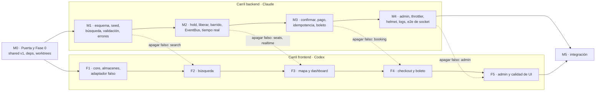

# Checklist de revisión y ejecución del proyecto

Esta lista organiza los pasos previstos desde el análisis y la arquitectura hasta la entrega de la kata. Las casillas representan tareas por revisar o ejecutar; no implican que una decisión documentada ya esté implementada.

Desde la revisión del 2026-11-18, las tareas pendientes se reparten en **tres carriles que trabajan en paralelo** sobre `git worktree` distintos: backend (Claude), frontend (Codex) e integración (humano y sesión integradora). La sección «Ejecución en paralelo» fija las reglas.

## Cómo usar esta lista

Cada tarea lleva una etiqueta de tipo, una de carril y una de hito:

| Etiqueta | Significado | Se marca cuando… |
| --- | --- | --- |
| **[D]** Decidir | Decisión o documentación de diseño | La decisión está escrita en `docs/architecture.md` (o en el registro de decisiones) y no deja preguntas abiertas. |
| **[I]** Implementar | Construcción en código, migraciones o configuración | El código está integrado en `develop` y compila. |
| **[V]** Verificar | Comprobación del comportamiento | Existe evidencia: un test, una captura, un comando reproducible o un enlace al documento. Anótala junto a la tarea. |

| Carril | Quién | Ámbito |
| --- | --- | --- |
| `@back` | Agente Claude, rama `lane/backend` | Solo `backend/**` |
| `@front` | Agente Codex, rama `lane/frontend` | Solo `frontend/**` |
| `@integ` | Humano y sesión integradora, rama `develop` | `packages/shared`, `docs/**`, scripts de la raíz, fusiones, verificación de extremo a extremo |

Hitos: `M0` (puerta y Fase 0), `M1` a `M4` (backend), `F1` a `F5` (frontend) y `M5` (integración). Una etiqueta como `@back M2` significa «carril backend, hito M2».

**Quién marca las casillas.** Solo el carril `@integ`. Cada carril anota qué hizo, el comando con su salida y las desviaciones en su archivo de seguimiento: [backend](handoff/backend.md) y [frontend](handoff/frontend.md). El integrador revisa esa evidencia, la enlaza aquí y marca.

Cada regla se define en un solo lugar (secciones 1 a 4). En las secciones posteriores solo se verifica o se implementa, y se remite a la regla original con «ver §X».

**Punteros.** Esta lista no repite el contenido de las decisiones; solo señala dónde están. `arch` = [architecture.md](architecture.md), `ctx` = `contexto-kata-reservas-vuelos.md` y `plan` = `analisis-arquitectura-kata.md`. Los dos últimos documentos no están en la carpeta del proyecto: si se copian a `docs/`, hay que actualizar estos punteros. Una nota **Pendiente:** explica por qué una tarea sigue abierta aunque el diseño ya la toque.

**Estado del diseño (revisión del 2026-11-18).** La puerta documental de M0 está cerrada para las secciones 4 y 6.2 de la kata. Existen contratos en `packages/shared`, configuración de los servicios, la ruta de salud y la entrada de Socket.IO. La preparación de los carriles, la implementación de las historias y su verificación se siguen en los hitos de abajo.

## Ejecución en paralelo

### Orden de trabajo

0. Alcance y decisiones técnicas → 1. Modelo de dominio → 2. Reglas y estados → 3. Esquema → 4. Contratos → **M0 · Puerta y Fase 0** → (en paralelo) **carril backend M1 → M4** y **carril frontend F1 → F5** → 7. Integración (M5) → 8. Calidad y entrega.

Las secciones 5 y 6 reparten el trabajo entre los carriles. No empiezan hasta cerrar M0, porque ahí se congelan los contratos y se crean los worktrees.

### Actores y carpetas

| Actor | Rama | Carpeta | Edita |
| --- | --- | --- | --- |
| Integrador | `develop` | `B:\PROYECTOS\DAVIVIENDA\aeropulse-flight-booking` | `packages/shared`, `docs/**` (salvo lo de cada carril), `package.json` raíz, `package-lock.json` y esta lista |
| Carril backend (Claude) | `lane/backend` | `B:\PROYECTOS\DAVIVIENDA\worktrees\lane-backend` | `backend/**`, `docs/handoff/backend.md` y su sección de `docs/ia.md` |
| Carril frontend (Codex) | `lane/frontend` | `B:\PROYECTOS\DAVIVIENDA\worktrees\lane-frontend` | `frontend/**`, `docs/handoff/frontend.md` y su sección de `docs/ia.md` |

**Rama base de esta primera corrida:** `develop`. Los carriles salen de ella y el integrador fusiona ahí cada hito (decisión del humano, 2026-11-18). `main` solo se toca en la entrega.

Los worktrees salen de un commit de `develop` con M0 integrado. Se crean desde la carpeta del repositorio:

```powershell
git worktree add -b lane/backend  ..\worktrees\lane-backend  develop
git worktree add -b lane/frontend ..\worktrees\lane-frontend develop
```

Cada worktree necesita su propio `npm ci`. En la app de escritorio de Codex se abre la carpeta `lane-frontend` y se trabaja directamente en ella; no se le pide crear otro worktree, para que la rama y la ruta coincidan con esta tabla.

### Reglas de aislamiento

1. **`packages/shared` queda congelado tras M0.** Si un carril necesita un cambio, se detiene y registra `CCR-n` en su archivo de seguimiento con el cambio pedido y el motivo. El integrador lo aplica en `develop`, actualiza el contrato en `contracts-and-open-questions.md` y el carril hace `git merge develop`.
2. **Sin dependencias nuevas en los carriles.** M0 instala de una vez las que el diseño pide al backend (`@nestjs/throttler`, `helmet`, `class-validator`, `class-transformer`). `socket.io-client` ya está en el frontend. Así `package-lock.json` no diverge entre ramas.
3. **Archivos de un solo dueño.** `libs/persistence/src/entities/index.ts`, `libs/persistence/src/migrations/index.ts` y `apps/api/src/app.module.ts` son del backend. `frontend/angular.json` es del frontend. Los scripts de `package.json` en la raíz son del integrador.
4. **`docs/ia.md`.** M0 crea dos subsecciones separadas, «Carril backend» y «Carril frontend». Cada carril escribe solo en la suya para que las fusiones no choquen.
5. **Base de datos.** Las pruebas usan Testcontainers, con puerto aleatorio, y no chocan entre sí. `npm run db:dev` publica el puerto fijo `5433`: solo un worktree lo ejecuta a la vez (backend o integrador).
6. **Fusión por hito.** Un hito se cierra cuando el carril ejecuta `npm run build`, `npm test` y `npm run lint` con salida limpia. Después el integrador fusiona con `git merge --no-ff` en `develop` y los carriles hacen `git merge develop`.
7. **Integración progresiva del frontend.** El adaptador falso se apaga por capacidad cuando el hito real llega a `develop`: búsqueda con M1, asientos y tiempo real con M2, reserva con M3 y administración con M4.

### Hitos y dependencias



| Hito | Entrega | Desbloquea |
| --- | --- | --- |
| M0 | Puerta cerrada, `packages/shared` v1, dependencias, worktrees y archivos de seguimiento | Los dos carriles |
| M1 | Entidades, migración, seed, validación, catálogo de errores y `GET /api/flights` | Búsqueda real en el frontend |
| M2 | Funciones puras de transición, `EventBus`, bloqueo, liberación, barrido y gateway de Socket.IO | Mapa, dashboard y tiempo real reales |
| M3 | Pago simulado, confirmación idempotente, boleto y evento de agotado | Checkout real |
| M4 | Administración, límite de tasa, cabeceras, registros y pruebas con `socket.io-client` | Administración real |
| F1 a F5 | Núcleo y adaptador falso, búsqueda, mapa y dashboard, checkout, administración y calidad de UI | Integración (M5) |
| M5 | Flujo real de extremo a extremo, Docker y evidencias de las secciones 6 y 8 | Entrega |

## 0. Alcance y decisiones técnicas

- [x] **[D]** Listar los requisitos de la kata con sus criterios de aceptación y lo que queda fuera de alcance. → `ctx` §3 y §7 (historias y criterios), `plan` §2 (requisitos derivados), `plan` §4 (recortes) y `arch` §10 (fuera de la entrega base).
- [x] **[D]** Registrar las decisiones de stack: backend, base de datos (PostgreSQL), frontend y transporte de tiempo real. → `arch` §1 y §6.
- [x] **[D]** Elegir la estrategia de concurrencia para el bloqueo y la confirmación y justificarla. → `arch` §4.2 a §4.4 (`UPDATE` condicional atómico más `UNIQUE` de respaldo; sin versión optimista).
- [x] **[D]** Elegir el mecanismo de expiración de bloqueos y justificarlo. → `arch` §4.5 (barrido de 1 s y expiración perezosa).
- [x] **[D]** Definir la fuente de tiempo: la hora de la base de datos, no la del cliente. → `arch` §4.3 y §4.5.
- [x] **[D]** Definir si habrá una o varias instancias del backend y cómo se distribuyen los eventos en cada caso. → `arch` §3.1 (una instancia, bus en proceso) y §10 (varias instancias con Redis).
- [x] **[D]** Definir la zona horaria y el formato de fechas de los vuelos. → `arch` §3.4 (todo en UTC: `timestamptz`, ISO 8601 con `Z`, interfaz etiquetada «UTC», búsqueda por día UTC).
- [x] **[D]** Mantener un registro de decisiones y preguntas abiertas. → `ctx` §9 (decisiones del enunciado), `arch` §6 (decisiones técnicas) y `plan` §8 (descartadas).

## 1. Modelo de dominio

- [x] **[D]** Decidir si se requiere una entidad de aeronave o si basta con generar los asientos por vuelo. → Decisión: no hay aeronave ni tabla de aeropuertos; el vuelo contiene sus asientos. `arch` §3.4.
- [x] **[D]** Identificar las entidades mínimas: vuelo, asiento asociado a un vuelo y reserva. → `arch` §3.4 (`flights`, `seats`, `bookings`).
- [x] **[D]** Definir la responsabilidad y los datos esenciales de cada entidad. → `arch` §3.3 (responsabilidades) y §3.4 (columnas y tipos).
- [x] **[D]** Fijar las relaciones y cardinalidades entre vuelo, asiento y reserva. → `arch` §3.4 (un vuelo tiene muchos asientos; un asiento tiene como máximo una reserva).
- [x] **[D]** Elaborar una tabla de entidades y relaciones y un diagrama entidad-relación. → `arch` §3.4.

## 2. Reglas de negocio y estados

Esta sección es la fuente única de las reglas. Las secciones 3 a 8 las implementan y verifican.

- [x] **[D]** Definir la identidad del «cliente» y cómo se identifica al titular de un bloqueo. → `arch` §5 (`clientId` en `sessionStorage` y `holdToken`).
- [x] **[D]** Documentar las transiciones del asiento, incluida la liberación al vencer el bloqueo. → `arch` §4.1 y §4.5.
- [x] **[D]** Definir la duración del bloqueo y si se puede renovar. → `arch` §4.5 (300 s; 30 s en demostraciones) y §4.3 (el reintento del titular no extiende el plazo).
- [x] **[D]** Precisar quién puede confirmar o liberar un bloqueo y qué ocurre si ya venció. Se requieren el identificador del titular y el token. Confirmar un bloqueo vencido devuelve `409 HOLD_INACTIVE`. Liberar devuelve `204` si ya no hay un bloqueo vigente y `409 HOLD_NOT_OWNED` si otro bloqueo sigue vigente. La liberación manual desde administración queda fuera del alcance. [Reglas de bloqueo y vencimiento](contracts-and-open-questions.md#bloqueo-liberación-y-vencimiento).
- [x] **[D]** Definir el comportamiento ante reintentos y la clave de idempotencia de la confirmación. → `arch` §4.3 y §4.4 (`Idempotency-Key`).
- [x] **[D]** Definir cómo afectan los estados del vuelo, en especial la cancelación, al bloqueo y la confirmación. → `arch` §4.3, §4.4 y §4.7.
- [x] **[D]** Definir cuándo un vuelo está agotado y si los bloqueados cuentan como ocupados. → `arch` §4.4 y §4.7 (agotado cuando ningún asiento queda sin `BOOKED`; los bloqueados no cuentan).

## 3. Esquema y restricciones de base de datos

El esquema del MVP, las decisiones de alistamiento y el orden de migración están documentados. [Persistencia y migraciones](persistence.md#alistamiento-antes-de-implementar).

- [x] **[D]** Definir tablas, columnas, tipos, claves primarias y foráneas. → `arch` §3.4.
- [x] **[D]** Definir índices y restricciones de unicidad, incluido el código de asiento por vuelo y el código de reserva. → `arch` §4.3 (`seats`), §4.4 (`bookings`) y §6 (código de reserva).
- [x] **[D]** Garantizar que un asiento no pueda tener más de una reserva confirmada. → `arch` §4.2 y §4.4 (`UNIQUE (flight_id, seat_code)`).
- [x] **[D]** Diseñar un mecanismo seguro ante concurrencia para limitar a un bloqueo activo por cliente y vuelo. → `arch` §4.3 y §3.4: índice único parcial `(flight_id, held_by) WHERE status = 'HELD'`, liberación del bloqueo previo antes de adquirir y un reintento ante `23505`. La prueba (dos bloqueos simultáneos del mismo cliente sobre asientos distintos) está asignada en la sección 5 a `@back M2`.
- [x] **[D]** Definir los datos de titularidad, vencimiento y versión necesarios para los bloqueos y la sincronización. → `arch` §4.3 (`held_by`, `hold_token`, `hold_expires_at`, `version`).
- [x] **[D]** Comprobar que las restricciones y las transacciones respaldan cada regla de la sección 2. → `arch` §3.4 («De regla a restricción»). Una regla («reserva existe si y solo si el asiento está `BOOKED`») se respalda con la transacción y su prueba de *rollback*, no con una restricción declarativa.

## 4. Contratos entre frontend y backend

- [x] **[D]** Definir consultas y comandos para búsqueda, selección, bloqueo y confirmación. [Rutas HTTP y respuestas](contracts-and-open-questions.md#rutas-http).
- [x] **[D]** Definir los datos y las versiones que transportan los eventos de asientos y vuelos. [Socket.IO](contracts-and-open-questions.md#socketio).
- [x] **[D]** Definir un catálogo de códigos de error consistente. [Catálogo de errores](contracts-and-open-questions.md#catálogo-de-errores).
- [x] **[D]** Definir las reglas de validación de entradas. [Convenciones y validaciones](contracts-and-open-questions.md#convenciones-y-validaciones).
- [x] **[D]** Revisar qué información recibe el titular y evitar exponer datos privados de otros bloqueos. [Instantáneas y eventos de Socket.IO](contracts-and-open-questions.md#socketio).
- [x] **[D]** Alinear el diseño de los contratos compartidos con las reglas del dominio mediante objetos de intercambio con campos explícitos. [Respuestas y cuerpo de confirmación](contracts-and-open-questions.md#respuestas-y-cuerpo-de-confirmación).

## M0 · Puerta de validación y Fase 0

Todo este bloque es `@integ M0` y es secuencial. Los carriles no empiezan hasta cerrarlo.

**Puerta de validación**

- [x] **[D]** `@integ` `M0` Revisar conjuntamente la tabla de entidades, sus relaciones y el diagrama entidad-relación.
  - **Validación documental del 2026-11-18.** Cada asiento pertenece directamente a un vuelo y el modelo prescinde de tablas de aeronaves y aeropuertos. La FK compuesta y `UNIQUE (flight_id, seat_code)` limitan a una reserva por asiento. El diagrama permite cero asientos por vuelo y el *seed* define 24 o 6 para los vuelos que genera. [Modelo de datos](persistence.md#modelo-de-datos).
  - `held_by`, `hold_token`, `hold_expires_at` y `version` cubren la titularidad, el vencimiento y la sincronización. El frontend recupera el bloqueo propio y calcula la cuenta regresiva con `serverNow` de PostgreSQL. [Contrato de tiempo real](contracts-and-open-questions.md#socketio).
  - El catálogo de 3 aeropuertos y 6 rutas cubre la demo con sus vuelos habituales de 24 asientos y el tercer horario de `BOG → MDE` con 6. Para mostrar «Agotado» debe haber una salida futura de ese horario en la ventana UTC del *seed*. La comprobación de la migración y el *seed* en PostgreSQL queda en M1. [Catálogo](business-rules.md#catálogo-y-datos-iniciales).
- [x] **[D]** `@integ` `M0` Validar las reglas de exclusividad, expiración e idempotencia antes de implementar el modelo.
  - **Validación documental del 2026-11-18.** El `UPDATE` condicional y los índices únicos protegen el asiento y el límite por titular y vuelo. El `hold` y la confirmación también comprueban el estado del vuelo bajo un bloqueo de fila cuando pueden coincidir con una cancelación. [Concurrencia](architecture.md#42-qué-garantiza-qué).
  - El barrido de 1 s y la adquisición directa comparten el límite `hold_expires_at <= now()` de PostgreSQL. Para una clave de compra ya confirmada, una huella igual devuelve `200` con el boleto original y una distinta devuelve `422`. Quedaron definidos los resultados y eventos esperados en las carreras. Las pruebas sobre PostgreSQL quedan en M2 y M3. [Casos de aceptación](contracts-and-open-questions.md#casos-de-aceptación-para-la-implementación).
- [x] **[D]** `@integ` `M0` Cerrar o asignar responsable y fecha a cada pregunta abierta.
  - **Revisión del 2026-11-18.** La sección 4 de la kata queda cubierta en el diseño por el monolito modular NestJS, Angular, REST, Socket.IO y `packages/shared`. La sección 6.2 queda cubierta por el diagrama (§2), la justificación (§3), concurrencia y sincronización (§4) y decisiones de stack, persistencia y caché (§6). [Arquitectura](architecture.md).
  - Quedaron definidas las suscripciones al navegar, la fusión de eventos parciales con instantáneas, la recuperación de estado y el arranque local de la demo. M2 implementa y prueba el reintento de la transacción ante un interbloqueo al cambiar de asiento. La evidencia de las cuatro historias con el sistema real se recoge en M5. [Casos de aceptación](contracts-and-open-questions.md#casos-de-aceptación-para-la-implementación).
  - La estructura actual compiló y pasó lint y las cuatro pruebas existentes. En un proyecto Compose aislado, con el archivo `.env` deshabilitado, Nginx sirvió Angular y se verificaron `GET /api/health` con PostgreSQL y la conexión WebSocket a `/ws`.

Resultado esperado: ninguna pregunta abierta que bloquee la implementación.

**Fase 0: preparar los carriles**

- [x] **[D]** `@integ` `M0` Documentar el reparto en carriles: esta lista, los archivos de seguimiento (`docs/handoff/backend.md` y `docs/handoff/frontend.md`), las subsecciones por carril de `docs/ia.md` y la sección «Carriles en paralelo» de `AGENTS.md`. Evidencia: creados el 2026-11-18, sin código.
- [x] **[I]** `@integ` `M0` Congelar `packages/shared` v1 a partir de [los contratos](contracts-and-open-questions.md): DTOs, enums de estado, códigos de error, aeropuertos del catálogo, `ServerToClientEvents` y `ClientToServerEvents`. Debe compilar en ESM y CommonJS (`npm run build:shared`). El paquete está integrado en `develop` desde `4516cc5`. `npm run build:shared` pasó y ESM y CommonJS tienen las mismas 23 exportaciones; 15 códigos de error iguales a los del contrato. El humano dio el visto bueno y congeló el contrato en el estado actual de `develop`. Evidencia: etiqueta `contracts-v1` sobre `bdd757f` (`packages/shared` no cambió desde `4516cc5`).
- [x] **[I]** `@integ` `M0` Instalar en un solo commit las dependencias de backend previstas (`@nestjs/throttler`, `helmet`, `class-validator` y `class-transformer`). `4516cc5` agregó las cuatro dependencias a `backend/package.json` y actualizó `package-lock.json`. Ambos archivos están en `develop` y se verificaron en la compilación y las pruebas registradas arriba.
- [x] **[I]** `@integ` `M0` Integrar en `develop` los commits de preparación. `4516cc5` incorporó los contratos, las dependencias y el reparto de carriles. `bdd757f` integró la validación del diseño y el arranque local de la demo.
- [ ] **[V]** `@integ` `M0` Crear los dos worktrees (ver «Actores y carpetas») desde `develop` una vez congelado el contrato. `git worktree list` solo muestra el checkout de `develop`. Falta crear `lane/backend` y `lane/frontend` y ejecutar `npm ci` y `npm run build` en cada uno.

## 5. Persistencia y concurrencia (carril `@back`)

Todo este bloque es del carril backend. Cada tarea indica su hito.

**M1 · Esquema, seed y base local**

- [ ] **[I]** `@back` `M1` Implementar entidades y migraciones versionadas conforme al esquema acordado (§3), registradas en `ENTITIES` y `MIGRATIONS`.
- [ ] **[V]** `@back` `M1` Aplicar, revertir y aplicar de nuevo la migración de negocio con los dos roles, y comprobar que `app` opera sobre los datos pero no cambia el esquema. Probar la integridad: estados parciales del bloqueo, claves foráneas y reservas duplicadas. [Verificación durante la implementación](persistence.md#verificación-durante-la-implementación). Evidencia: _(test)_
- [ ] **[I]** `@back` `M1` Preparar datos iniciales reproducibles, con fechas adecuadas para la evaluación y el vuelo de demostración de seis asientos.
- [ ] **[V]** `@back` `M1` Reejecutar el seed sin cambiar estado, tarifa, bloqueos ni reservas de los vuelos existentes. Evidencia: _(test)_
- [ ] **[I]** `@back` `M1` Arrancar PostgreSQL local con Compose y verificar el flujo de desarrollo. La prueba aislada de arranque y roles ya pasó en PostgreSQL 17. [Comandos y evidencia](persistence.md#alistamiento-antes-de-implementar). El puerto `5433` es compartido: ver la regla 5.

**M2 · Dominio, bloqueo y expiración**

- [ ] **[I]** `@back` `M2` Implementar en `libs/domain` las funciones puras de transición del asiento, con pruebas unitarias.
- [ ] **[V]** `@back` `M2` Probar contra PostgreSQL real que solicitudes simultáneas por un mismo asiento producen un único bloqueo exitoso (50 `hold` simultáneos: 1 éxito y 49 `409`). Evidencia: _(test)_
- [ ] **[V]** `@back` `M2` Verificar la expiración y liberación de bloqueos, incluso sin clientes conectados (§0, §2). Evidencia: _(test)_
- [ ] **[V]** `@back` `M2` Probar el reintento idempotente del bloqueo, la titularidad de la liberación y la restricción de un bloqueo activo por cliente y vuelo, incluidos dos bloqueos simultáneos del mismo cliente sobre asientos distintos. Probar que un interbloqueo al cambiar de asiento se revierte antes de reintentar. [Bloqueo atómico](architecture.md#43-bloqueo-atómico-idempotente-para-su-titular). Evidencia: _(test)_
- [ ] **[V]** `@back` `M2` Verificar que el servidor rechaza el bloqueo en vuelos cancelados (§2). Evidencia: _(test)_

**M3 · Confirmación y pago**

- [ ] **[I]** `@back` `M3` Implementar en `libs/domain` la generación del código de reserva y la validación de Luhn, con pruebas unitarias.
- [ ] **[V]** `@back` `M3` Verificar que la confirmación y sus escrituras son atómicas y que un error provoca *rollback* (asiento `HELD` y sin reserva). Evidencia: _(test)_
- [ ] **[V]** `@back` `M3` Probar los reintentos y la idempotencia de la confirmación (misma clave, mismo boleto; 20 peticiones simultáneas, una reserva), la titularidad y el agotado con dos confirmaciones simultáneas de los dos últimos asientos (§2). Evidencia: _(test)_
- [ ] **[V]** `@back` `M3` Verificar que el servidor rechaza la confirmación en vuelos cancelados (§2). Evidencia: _(test)_

**M4 · Registros**

- [ ] **[I]** `@back` `M4` Añadir registro (logs) básico de bloqueos, confirmaciones, expiraciones y conflictos, útil para depurar y para la demostración. Sin tokens, identificadores de cliente ni datos de pago.

## 6. Flujo funcional y tiempo real

### 6.A Backend (carril `@back`)

- [ ] **[I]** `@back` `M1` Implementar la validación de entradas y el catálogo de errores de §4 (`ValidationPipe` estricta, forma `{ error: { code, message } }`, `fields` en `VALIDATION_ERROR`) y `GET /api/flights`. [Especificación de contratos](contracts-and-open-questions.md).
- [ ] **[I]** `@back` `M2` Implementar `EventBus` (puerto y adaptador en proceso), `POST` y `DELETE` del bloqueo, el barrido de 1 s y el *gateway* de Socket.IO (`join`, instantánea con `myHold` y `seat.changed`).
- [ ] **[I]** `@back` `M3` Implementar `PaymentGateway` con su simulador, `POST /api/bookings/confirm`, `GET /api/bookings/{code}` y el evento `flight.status_changed` por agotado.
- [ ] **[I]** `@back` `M4` Implementar `PATCH /api/admin/flights/{flightId}/status` con `AdminTokenGuard`, además de límite de tasa, `helmet` y el arranque seguro en producción.
- [ ] **[V]** `@back` `M4` Con un cliente `socket.io-client` real: `join` devuelve instantánea y `myHold`; un evento anterior al *ack* se funde sin perderse; el `PATCH` de administración llega a la sala `search`. Evidencia: _(test)_

### 6.B Frontend (carril `@front`)

Hasta que llegue cada hito real, el frontend trabaja contra un adaptador falso en memoria que cumple los contratos de §4: versiones crecientes, vencimiento del bloqueo, `409`, `402` y eventos. Es un `HttpInterceptorFn` y una fábrica de socket inyectable, activos solo en la configuración `fake`; no son puertos nuevos. El humano lo aprobó el 2026-11-18 como primera versión, para no sumar complejidad al desarrollo inicial.

- [ ] **[I]** `@front` `F1` Implementar el núcleo: `clientId` en `sessionStorage`, cliente HTTP tipado con `shared` (`X-Client-Id`, `Idempotency-Key`), servicio de socket (`join` solo en `connect`, `auth.clientId`, `transports: ['websocket']`) y traducción de errores por `code`.
- [ ] **[I]** `@front` `F1` Implementar el almacén por vuelo y el almacén de vuelos con fusión por `version` (`arch` §4.6), con los contadores como `computed()`.
- [ ] **[V]** `@front` `F1` Probar fusión por versión, duplicados, eventos de vuelo antes de cargar el catálogo, descarte del bloqueo propio y cambio de suscripción al navegar entre vuelos. [Sincronización](architecture.md#46-consistencia-del-cliente-fusión-por-versión). Evidencia: _(test)_
- [ ] **[I]** `@front` `F1` Implementar el adaptador falso descrito arriba y la configuración `fake` en `angular.json`.
- [ ] **[I]** `@front` `F2` Implementar la búsqueda (HU1): formulario, listado con UTC visible, estados cancelado y agotado, y actualización en su lugar con `flight.status_changed`.
- [ ] **[I]** `@front` `F3` Implementar el mapa de asientos (HU2): selección con bloqueo, asiento propio resaltado, cuenta regresiva con `holdExpiresAt` y `serverNow`, recuperación con `myHold` y reversión ante `409`.
- [ ] **[I]** `@front` `F3` Implementar el dashboard (HU4) con los contadores `computed()` del mismo almacén que pinta el mapa.
- [ ] **[I]** `@front` `F4` Implementar el checkout (HU3): tarjetas de prueba visibles, una `Idempotency-Key` por intento de compra, boleto con código y consulta por código y apellido.
- [ ] **[I]** `@front` `F5` Implementar el área de administración en carga diferida, con *guard* y cambio de estado de vuelos.
- [ ] **[I]** `@front` `F2` a `F5` Apagar el adaptador falso por capacidad cuando el hito real llega a `develop`: `search` (M1), `seats` y `realtime` (M2), `booking` (M3) y `admin` (M4). Evidencia: _(lista de capacidades reales en el seguimiento del carril)_

### 6.C Verificación del flujo (carril `@integ`)

Estas comprobaciones necesitan frontend y backend reales, así que se hacen en M5. El carril frontend puede aportar una pre-evidencia con el adaptador falso, pero no sustituye la evidencia final.

- [ ] **[V]** `@integ` `M5` Reflejar los cambios de asiento en tiempo real entre dos pestañas o navegadores. Evidencia: _(captura o test e2e)_
- [ ] **[V]** `@integ` `M5` Actualizar el listado ante cambios de estado o agotamiento de un vuelo (§2). Evidencia: _(captura o test e2e)_
- [ ] **[V]** `@integ` `M5` Mostrar en el dashboard los conteos de asientos disponibles, bloqueados y reservados. Evidencia: _(captura)_
- [ ] **[V]** `@integ` `M5` Verificar la recuperación del estado tras una desconexión o recarga y el manejo de eventos duplicados o desordenados (usando las versiones de §4). Evidencia: _(test)_
- [ ] **[V]** `@integ` `M5` Comprobar los mensajes para conflictos, vencimiento y pérdida de conexión, según el catálogo de errores de §4. Evidencia: _(captura)_

## 7. Integración real (hito M5, carril `@integ`)

Empieza cuando M4 y F5 están en `develop`.

- [ ] **[I]** `@integ` `M5` Dejar el backend real como configuración por defecto del frontend. La configuración `fake` queda solo como opción de desarrollo o se elimina.
- [ ] **[V]** `@integ` `M5` Ejecutar `docker compose up --build` sin `.env` y comprobar `GET /api/health` con consulta real a la base. Evidencia: _(comando y salida)_
- [ ] **[V]** `@integ` `M5` Recorrer el flujo completo con el stack real: búsqueda, mapa, bloqueo, confirmación y boleto. Evidencia: _(captura o test e2e)_
- [ ] **[V]** `@integ` `M5` Reproducir la demostración del vuelo de seis asientos: agotarlo en una pestaña y ver «Agotado» en otra sin recargar. Evidencia: _(captura)_

## 8. Calidad y entrega

- [ ] **[V]** `@front` `F5` Revisar navegación por teclado, etiquetas, foco visible, contraste y estados accesibles.
- [ ] **[V]** `@front` `F5` Revisar estados de carga, vacío y error, así como la adaptación a pantallas pequeñas (desde 360 px).
- [ ] **[I]** `@integ` `M5` Disponer de un comando o pipeline único que compile y ejecute todas las pruebas, incluidas las de concurrencia. Propuesta: un script `verify` en la raíz con `build`, `lint` y `test`.
- [ ] **[V]** `@integ` `M5` Ejecutar ese comando y confirmar que pasa.
- [ ] **[V]** `@integ` `M5` Contrastar `docs/architecture.md` con el comportamiento realmente implementado y corregir las diferencias, usando los cambios que cada carril anotó en su seguimiento.
- [ ] **[V]** `@integ` `M5` Contrastar la lista de requisitos de la sección 0 con lo entregado: cada requisito cubierto, con su evidencia, o declarado como limitación.
- [ ] **[D]** `@integ` `M5` Completar `docs/ia.md` con el uso de herramientas, prompts, correcciones y aportes. Cada carril ya alimenta su subsección; el integrador la unifica y cierra.
- [ ] **[D]** `@integ` `M5` Verificar que el README explique cómo instalar, ejecutar y probar el proyecto.
- [ ] **[V]** `@integ` `M5` Probar la ejecución y la demostración desde un clon limpio del repositorio.
- [ ] **[V]** `@integ` `M5` Confirmar que el repositorio de entrega sea público y accesible.
- [ ] **[D]** `@integ` `M5` Preparar la demostración y la sustentación de las decisiones y limitaciones (apoyándose en el registro de decisiones de la sección 0).
