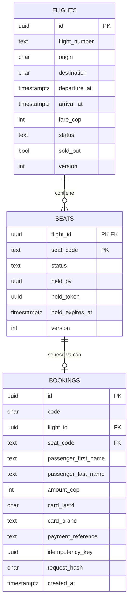

# Persistencia · Entidades, relaciones y migraciones

Este documento fija el esquema inicial del MVP. Las entidades y la migración de negocio se implementan y verifican a partir de este diseño. [Arquitectura](architecture.md) · [Reglas de negocio](business-rules.md) · [Contratos entre frontend y backend](contracts-and-open-questions.md).

## Modelo de datos

Alcance mínimo para la kata: **un catálogo cerrado y tres tablas**. No hay entidad de aeronave ni tabla de aeropuertos: el vuelo contiene directamente sus asientos.

| Historia | Qué necesita de la base |
| --- | --- |
| HU1 · Buscar vuelos | Ruta y horario para filtrar por día UTC, tarifa, estado operativo, indicador de agotamiento y versión en `flights`. |
| HU2 · Seleccionar y bloquear | Asientos por vuelo, estado, titular, token y vencimiento en `seats`. La clave del asiento y el índice por titular limitan los bloqueos simultáneos. |
| HU3 · Confirmar y consultar el boleto | `bookings` vincula un asiento con su pasajero, el importe confirmado, el código del boleto y la clave de idempotencia. La reserva y el estado del asiento se escriben en una sola transacción. |
| HU4 · Consultar la ocupación | El mapa y el dashboard usan los estados y versiones de `seats`. Los conteos se derivan en el cliente, tal como establece el contrato. |

**Catálogo cerrado (lo escribe solo el *seed*)**

| Parámetro | Valor |
| --- | --- |
| Aeropuertos | `BAQ` Barranquilla, `BOG` Bogotá, `MDE` Medellín. Lista fija en `packages/shared` y en un `CHECK` de la base; no hay tabla |
| Rutas | 6: cada par ordenado de aeropuertos distintos |
| Horarios | De 1 a 3 por ruta y día, fijos y en UTC. La ruta `BOG→MDE` tiene 3 |
| Ventana de fechas | Desde hoy hasta el último día del mes en curso, ambos en UTC, solo con salida futura. Se calcula cuando se ejecuta el *seed* |
| Asientos por vuelo | 24: filas 1 a 6 × columnas `A`–`D` |
| Vuelo de demostración | El tercer horario de `BOG→MDE`, con 6 asientos (filas 1 y 2 × columnas `A`–`C`), para poder agotarlo en la demo ([sección 4.7 de arquitectura](architecture.md#47-cambios-de-estado-de-vuelos-hu1)) |

Límite conocido: si el *seed* se ejecuta el último día del mes, solo hay vuelos de ese día.

**Tiempo y zona.** Todo se maneja en **UTC**: las columnas son `timestamptz`, la API envía fechas ISO 8601 con `Z`, la interfaz muestra las horas con la etiqueta «UTC» y la búsqueda por fecha es por día UTC. No se convierten zonas horarias.



Todas las columnas son `NOT NULL` excepto `seats.held_by`, `seats.hold_token` y `seats.hold_expires_at`. El *seed* y la aplicación asignan los UUID v4 de los vuelos y las reservas al crearlos. Las claves foráneas usan `ON DELETE RESTRICT` y las claves referenciadas permanecen estables.

**`flights`**

| Columna | Tipo | Notas |
| --- | --- | --- |
| `id` | `uuid` PK | |
| `flight_number` | `varchar(8)` | Por ejemplo `AP101` |
| `origin`, `destination` | `char(3)` | Solo `BAQ`, `BOG`, `MDE`, y distintos entre sí |
| `departure_at`, `arrival_at` | `timestamptz` | UTC; la llegada es posterior a la salida |
| `fare_cop` | `integer` | Tarifa positiva en pesos colombianos |
| `status` | `varchar(10)` | `SCHEDULED` por defecto. También admite `DELAYED` y `CANCELLED` |
| `sold_out` | `boolean` | Por defecto `false`; se marca en la confirmación ([sección 4.4 de arquitectura](architecture.md#44-confirmación-pago-simulado-y-agotado)) |
| `version` | `integer` | Por defecto 1; sube en cada cambio |

**`seats`** (clave primaria compuesta `(flight_id, seat_code)`)

| Columna | Tipo | Notas |
| --- | --- | --- |
| `flight_id` | `uuid` FK → `flights` | |
| `seat_code` | `varchar(3)` | Número de fila y letra, por ejemplo `12A` |
| `status` | `varchar(9)` | `AVAILABLE` por defecto. También admite `HELD` y `BOOKED` |
| `held_by` | `uuid` nulo | `clientId` del titular; nunca se difunde |
| `hold_token` | `uuid` nulo | Se entrega solo al titular |
| `hold_expires_at` | `timestamptz` nulo | Vencimiento, con el reloj de la base |
| `version` | `integer` | Por defecto 1; sube en cada cambio |

**`bookings`**

| Columna | Tipo | Notas |
| --- | --- | --- |
| `id` | `uuid` PK | |
| `code` | `char(6)` | Código de reserva ([sección 6 de arquitectura](architecture.md#6-decisiones-técnicas-clave)) |
| `flight_id`, `seat_code` | FK compuesta → `seats` | |
| `passenger_first_name`, `passenger_last_name` | `varchar(60)` | El apellido sirve para consultar el boleto |
| `amount_cop` | `integer` | Importe positivo que se copia de la tarifa del vuelo al confirmar |
| `card_last4`, `card_brand`, `payment_reference` | `char(4)`, `varchar(20)`, `varchar(40)` | Nunca el número completo ([sección 4.4 de arquitectura](architecture.md#44-confirmación-pago-simulado-y-agotado)) |
| `idempotency_key` | `uuid` | Clave UUID v4 enviada en el encabezado `Idempotency-Key`. La API valida la versión |
| `request_hash` | `char(64)` | SHA-256 de la solicitud ([sección 4.4 de arquitectura](architecture.md#44-confirmación-pago-simulado-y-agotado)) |
| `created_at` | `timestamptz` | Por defecto `now()` |

**De regla a restricción.** Cada regla del diseño debe quedar respaldada por algo que la base o la sentencia impongan:

| Regla | Restricción o mecanismo | Dónde |
| --- | --- | --- |
| Aeropuertos del catálogo y origen distinto del destino | `CHECK` sobre `origin` y `destination` | Base |
| La llegada es posterior a la salida | `CHECK (arrival_at > departure_at)` | Base |
| Un vuelo no se repite | `UNIQUE (flight_number, departure_at)` | Base |
| El importe y las versiones son positivos | `CHECK (fare_cop > 0)`, `CHECK (amount_cop > 0)` y `CHECK (version > 0)` en las tablas correspondientes | Base |
| Estados válidos del vuelo y del asiento | `CHECK (status IN (…))` | Base |
| El código de asiento es único dentro del vuelo y tiene formato válido | PK `(flight_id, seat_code)` y `CHECK (seat_code ~ '^[0-9]{1,2}[A-D]$')` | Base |
| Los tres campos del bloqueo tienen valor en `HELD` y son nulos en `AVAILABLE` y `BOOKED` | `CHECK` de consistencia del bloqueo, definido abajo | Base |
| Dos bloqueos simultáneos del mismo asiento producen uno solo | `UPDATE` condicional atómico ([sección 4.3 de arquitectura](architecture.md#43-bloqueo-atómico-idempotente-para-su-titular)) | Sentencia |
| Un solo bloqueo activo por cliente y vuelo | `UNIQUE (flight_id, held_by) WHERE status = 'HELD'`; el bloqueo libera primero el anterior y, ante `23505`, se reintenta una vez ([sección 4.3 de arquitectura](architecture.md#43-bloqueo-atómico-idempotente-para-su-titular)) | Base y transacción |
| No se bloquea ni confirma en un vuelo cancelado | El `hold` filtra con `EXISTS`. Después de modificar el asiento, el `hold` comprueba el vuelo con `FOR SHARE` y la confirmación con `FOR UPDATE`, antes del *commit*. Ambas revierten si el vuelo está cancelado. [Bloqueo](architecture.md#43-bloqueo-atómico-idempotente-para-su-titular) · [Confirmación](architecture.md#44-confirmación-pago-simulado-y-agotado) | Sentencia y transacción |
| No se confirma un bloqueo vencido o ajeno | `WHERE status = 'HELD' AND held_by = :clientId AND hold_token = :token AND hold_expires_at > now()` ([sección 4.4 de arquitectura](architecture.md#44-confirmación-pago-simulado-y-agotado)) | Sentencia |
| Un asiento no tiene más de una reserva | `UNIQUE (flight_id, seat_code)` en `bookings` | Base |
| La reserva apunta a un asiento existente | FK compuesta `(flight_id, seat_code)` | Base |
| El código de reserva es único y cumple el formato del contrato | `UNIQUE (code)` con reintento ante colisión y `CHECK (code ~ '^[A-HJ-NP-Z2-9]{6}$')` | Base |
| Un intento de compra produce un solo boleto | `UNIQUE (idempotency_key)` ([sección 4.4 de arquitectura](architecture.md#44-confirmación-pago-simulado-y-agotado)) | Base |
| Una reserva existe si y solo si el asiento está `BOOKED` | Una sola transacción con el mismo `EntityManager`; la vigila la prueba de *rollback* ([sección 8 de arquitectura](architecture.md#8-pruebas)) | Transacción |
| `version` sube en cada cambio | Todo `UPDATE` incluye `version = version + 1`; la vigilan las pruebas | Aplicación |

La correspondencia entre una reserva y el asiento `BOOKED` se garantiza mediante la transacción de confirmación. Se verificará con la prueba de *rollback*.

### Consistencia de los campos del bloqueo

```sql
CHECK (
  (status = 'HELD'
    AND held_by IS NOT NULL
    AND hold_token IS NOT NULL
    AND hold_expires_at IS NOT NULL)
  OR
  (status IN ('AVAILABLE', 'BOOKED')
    AND held_by IS NULL
    AND hold_token IS NULL
    AND hold_expires_at IS NULL)
)
```

Un bloqueo vencido puede seguir en estado `HELD` hasta el barrido o una nueva adquisición. La fecha determina la vigencia en la operación que lee o cambia el asiento. Liberar, expirar o confirmar cambia el estado y pone los tres campos en `NULL` en la misma sentencia.

### Índices para el MVP

Además de los índices de las claves primarias y restricciones `UNIQUE`, la primera migración crea estos tres índices.

| Índice | Columnas y filtro | Uso |
| --- | --- | --- |
| `flights_route_departure_idx` | `(origin, destination, departure_at, id)` | Busca por ruta y rango UTC, con orden por salida e identificador. |
| `seats_held_expiry_idx` | `(hold_expires_at) WHERE status = 'HELD'` | Localiza los bloqueos vencidos para el barrido. |
| `seats_flight_holder_uidx` | Único sobre `(flight_id, held_by) WHERE status = 'HELD'` | Impide que un titular tenga dos filas `HELD` en el mismo vuelo. |

La PK de `seats` sirve para leer el mapa por vuelo y localizar un asiento. El índice único de `bookings.code` localiza el boleto antes de validar el apellido.

---

## Migraciones y responsabilidades

- El esquema se versiona mediante migraciones TypeORM; `synchronize` permanece en `false`.
- `backend/libs/persistence` concentra entidades, migraciones y configuración de conexión. La aplicación `backend/apps/migrate` ejecuta las migraciones y el seed con el rol propietario; la API utiliza el rol `app` para operaciones de datos, sin permisos de modificación del esquema.
- La migración existente `AppRoleGrants` configura privilegios por defecto para tablas y secuencias posteriores. Las migraciones de negocio deben incluir creación y reversión (`up` y `down`) y probarse con los roles correspondientes.
- Como webpack agrupa el backend, cada entidad y migración debe registrarse explícitamente en los arreglos `ENTITIES` y `MIGRATIONS`; no se depende de patrones de archivos.
- El *seed* se ejecuta después de aplicar el esquema. Usa `(flight_number, departure_at)`, donde `departure_at` es el instante exacto de salida en UTC, como clave natural de cada vuelo. Usa `(flight_id, seat_code)` para sus asientos. El número de vuelo es fijo por ruta y horario del catálogo, y se reutiliza en fechas distintas.
- Al reejecutar el *seed*, las inserciones usan `ON CONFLICT DO NOTHING` con esas claves. Se recupera el identificador del vuelo existente para completar asientos faltantes y se conservan su estado, tarifa, bloqueos y reservas.

### Orden de la primera migración de negocio

1. **`up()`.** Tras `AppRoleGrants`, crear `flights`, luego `seats` con su FK a `flights`, y luego `bookings` con su FK compuesta a `seats`. Cada tabla nace con sus claves y restricciones. Crear después los tres índices explícitos de la sección anterior.
2. **`down()`.** En una base de pruebas, quitar los tres índices explícitos en orden inverso y eliminar `bookings`, `seats` y `flights` en ese orden. Cada tabla elimina sus propias restricciones e índices asociados. Evitar `CASCADE` para que una dependencia inesperada detenga la reversión. `AppRoleGrants` sigue siendo una migración independiente.

## Alistamiento antes de implementar

- [x] Validar columnas, nulabilidad, claves, índices y restricciones contra HU1–HU4.
- [x] Cerrar el `CHECK` de consistencia de los campos del bloqueo.
- [x] Unificar la clave natural del *seed* y su restricción `UNIQUE`.
- [x] Definir el orden de creación y reversión.
- [x] Comprobar conexión y permisos de ambos roles en PostgreSQL 17. La prueba de alistamiento pasó sus tres casos con `AppRoleGrants` y una tabla de prueba.

Para comprobar la base de PostgreSQL 17 y los roles, usar la prueba existente. Testcontainers inicia una instancia temporal con el mismo script de roles que Compose.

```powershell
npm test -w backend -- --runInBand --runTestsByPath test/persistence/migrations.spec.ts
```

Para arrancar PostgreSQL en modo desarrollo, con acceso desde `127.0.0.1:5433`, ejecutar desde la raíz del repositorio:

```powershell
docker compose -f docker-compose.yml -f compose.dev.yaml up -d --wait db
```

## Verificación durante la implementación

- [ ] Aplicar, revertir y aplicar otra vez la primera migración de negocio en PostgreSQL real. Verificar el acceso del propietario y que `app` pueda operar sobre los datos, pero no modificar el esquema.
- [ ] Probar integridad del esquema, incluidos los estados parciales del bloqueo, las FK, las reservas duplicadas y la reejecución del *seed* sin cambios en el inventario.
- [ ] Probar concurrencia y *rollback* al implementar bloqueo y confirmación. [Casos de aceptación del contrato](contracts-and-open-questions.md#casos-de-aceptación-para-la-implementación).
- [ ] Contrastar este documento con las migraciones y entidades implementadas.
