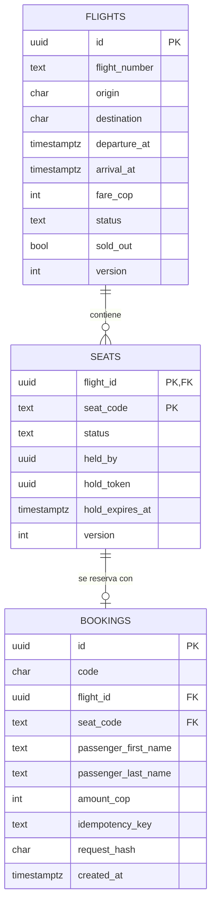

# Persistencia · Entidades, relaciones y migraciones

Este documento desarrolla el modelo de datos y la estrategia de persistencia previstos en [architecture.md](architecture.md). Es un diseño previo a la implementación: las entidades y las migraciones de negocio aún deben implementarse y verificarse. Las decisiones funcionales del catálogo están en [reglas de negocio](business-rules.md).

## Modelo de datos

Alcance mínimo para la kata: **un catálogo cerrado y tres tablas**. No hay entidad de aeronave ni tabla de aeropuertos: el vuelo contiene directamente sus asientos.

**Catálogo cerrado (lo escribe solo el *seed*)**

| Parámetro | Valor |
| --- | --- |
| Aeropuertos | `BAQ` Barranquilla, `BOG` Bogotá, `MDE` Medellín. Lista fija en `packages/shared` y en un `CHECK` de la base; no hay tabla |
| Rutas | 6: cada par ordenado de aeropuertos distintos |
| Horarios | De 1 a 3 por ruta y día, fijos y en UTC. La ruta `BOG→MDE` tiene 3 |
| Ventana de fechas | Desde hoy hasta el último día del mes en curso, ambos en UTC, solo con salida futura. Se calcula cuando se ejecuta el *seed* |
| Asientos por vuelo | 24: filas 1 a 6 × columnas `A`–`D` |
| Vuelo de demostración | El tercer horario de `BOG→MDE`, con 6 asientos (filas 1 y 2 × columnas `A`–`C`), para poder agotarlo en la demo ([sección 4.7 de arquitectura](architecture.md#47-cambios-de-estado-de-vuelos-hu1)) |

Límite conocido: si el *seed* se ejecuta el último día del mes, solo hay vuelos de ese día.

**Tiempo y zona.** Todo se maneja en **UTC**: las columnas son `timestamptz`, la API envía fechas ISO 8601 con `Z`, la interfaz muestra las horas con la etiqueta «UTC» y la búsqueda por fecha es por día UTC. No se convierten zonas horarias.

**`flights`**

| Columna | Tipo | Notas |
| --- | --- | --- |
| `id` | `uuid` PK | |
| `flight_number` | `varchar(8)` | Por ejemplo `AP101` |
| `origin`, `destination` | `char(3)` | Solo `BAQ`, `BOG`, `MDE`, y distintos entre sí |
| `departure_at`, `arrival_at` | `timestamptz` | UTC; la llegada es posterior a la salida |
| `fare_cop` | `integer` | Una tarifa por vuelo, en pesos colombianos |
| `status` | `varchar(10)` | `SCHEDULED`, `DELAYED` o `CANCELLED` |
| `sold_out` | `boolean` | Por defecto `false`; se marca en la confirmación ([sección 4.4 de arquitectura](architecture.md#44-confirmación-pago-simulado-y-agotado)) |
| `version` | `integer` | Por defecto 1; sube en cada cambio |

**`seats`** (clave primaria compuesta `(flight_id, seat_code)`)

| Columna | Tipo | Notas |
| --- | --- | --- |
| `flight_id` | `uuid` FK → `flights` | |
| `seat_code` | `varchar(3)` | Número de fila y letra, por ejemplo `12A` |
| `status` | `varchar(9)` | `AVAILABLE`, `HELD` o `BOOKED` |
| `held_by` | `uuid` nulo | `clientId` del titular; nunca se difunde |
| `hold_token` | `uuid` nulo | Se entrega solo al titular |
| `hold_expires_at` | `timestamptz` nulo | Vencimiento, con el reloj de la base |
| `version` | `integer` | Por defecto 1; sube en cada cambio |

**`bookings`**

| Columna | Tipo | Notas |
| --- | --- | --- |
| `id` | `uuid` PK | |
| `code` | `char(6)` | Código de reserva ([sección 6 de arquitectura](architecture.md#6-decisiones-técnicas-clave)) |
| `flight_id`, `seat_code` | FK compuesta → `seats` | |
| `passenger_first_name`, `passenger_last_name` | `varchar(60)` | El apellido sirve para consultar el boleto |
| `amount_cop` | `integer` | Tarifa cobrada, copiada del vuelo |
| `card_last4`, `card_brand`, `payment_reference` | `char(4)`, `varchar(20)`, `varchar(40)` | Nunca el número completo ([sección 4.4 de arquitectura](architecture.md#44-confirmación-pago-simulado-y-agotado)) |
| `idempotency_key` | `varchar(64)` | |
| `request_hash` | `char(64)` | SHA-256 de la solicitud ([sección 4.4 de arquitectura](architecture.md#44-confirmación-pago-simulado-y-agotado)) |
| `created_at` | `timestamptz` | Por defecto `now()` |

**De regla a restricción.** Cada regla del diseño debe quedar respaldada por algo que la base o la sentencia impongan:

| Regla | Restricción o mecanismo | Dónde |
| --- | --- | --- |
| Aeropuertos del catálogo y origen distinto del destino | `CHECK` sobre `origin` y `destination` | Base |
| La llegada es posterior a la salida | `CHECK (arrival_at > departure_at)` | Base |
| Un vuelo no se repite | `UNIQUE (flight_number, departure_at)` | Base |
| Estados válidos del vuelo y del asiento | `CHECK (status IN (…))` | Base |
| El código de asiento es único dentro del vuelo y tiene formato válido | PK `(flight_id, seat_code)` y `CHECK (seat_code ~ '^[0-9]{1,2}[A-D]$')` | Base |
| `HELD` implica titular, token y vencimiento (y al revés) | `CHECK ((status = 'HELD') = (held_by IS NOT NULL AND hold_token IS NOT NULL AND hold_expires_at IS NOT NULL))` | Base |
| Dos bloqueos simultáneos del mismo asiento producen uno solo | `UPDATE` condicional atómico ([sección 4.3 de arquitectura](architecture.md#43-bloqueo-atómico-idempotente-para-su-titular)) | Sentencia |
| Un solo bloqueo activo por cliente y vuelo | `UNIQUE (flight_id, held_by) WHERE status = 'HELD'`; el bloqueo libera primero el anterior y, ante `23505`, se reintenta una vez ([sección 4.3 de arquitectura](architecture.md#43-bloqueo-atómico-idempotente-para-su-titular)) | Base y transacción |
| No se bloquea ni confirma en un vuelo cancelado | Condición `EXISTS` en el bloqueo y comprobación del estado bajo bloqueo de la fila del vuelo antes de confirmar ([sección 4.3 de arquitectura](architecture.md#43-bloqueo-atómico-idempotente-para-su-titular), [sección 4.4 de arquitectura](architecture.md#44-confirmación-pago-simulado-y-agotado)) | Sentencia y transacción |
| No se confirma un bloqueo vencido o ajeno | `WHERE status = 'HELD' AND held_by = :clientId AND hold_token = :token AND hold_expires_at > now()` ([sección 4.4 de arquitectura](architecture.md#44-confirmación-pago-simulado-y-agotado)) | Sentencia |
| Un asiento no tiene más de una reserva | `UNIQUE (flight_id, seat_code)` en `bookings` | Base |
| La reserva apunta a un asiento existente | FK compuesta `(flight_id, seat_code)` | Base |
| El código de reserva es único | `UNIQUE (code)` con reintento ante colisión | Base |
| Un intento de compra produce un solo boleto | `UNIQUE (idempotency_key)` ([sección 4.4 de arquitectura](architecture.md#44-confirmación-pago-simulado-y-agotado)) | Base |
| Una reserva existe si y solo si el asiento está `BOOKED` | Una sola transacción con el mismo `EntityManager`; la vigila la prueba de *rollback* ([sección 8 de arquitectura](architecture.md#8-pruebas)) | Transacción |
| `version` sube en cada cambio | Todo `UPDATE` incluye `version = version + 1`; la vigilan las pruebas | Aplicación |

La penúltima regla no tiene restricción declarativa: una base de datos no expresa «existe si y solo si» entre dos tablas sin un disparador. Se acepta porque ambas escrituras viven en una transacción y hay una prueba que lo comprueba.

---

## Migraciones y responsabilidades

- El esquema se versiona mediante migraciones TypeORM; `synchronize` permanece en `false`.
- `backend/libs/persistence` concentra entidades, migraciones y configuración de conexión. La aplicación `backend/apps/migrate` ejecuta las migraciones y el seed con el rol propietario; la API utiliza el rol `app` para operaciones de datos, sin permisos de modificación del esquema.
- La migración existente `AppRoleGrants` configura privilegios por defecto para tablas y secuencias posteriores. Las migraciones de negocio deben incluir creación y reversión (`up` y `down`) y probarse con los roles correspondientes.
- Como webpack agrupa el backend, cada entidad y migración debe registrarse explícitamente en los arreglos `ENTITIES` y `MIGRATIONS`; no se depende de patrones de archivos.
- El seed es idempotente y crea el catálogo y los asientos definidos en [reglas de negocio](business-rules.md). Revisar que su clave natural coincida con la restricción de unicidad del esquema.

## Revisión antes de implementar

- [ ] Validar columnas, nulabilidad, claves, índices y restricciones con las reglas de negocio.
- [ ] Revisar el `CHECK` de campos de bloqueo: la expresión propuesta permite campos parcialmente informados cuando el estado no es `HELD`; acordar una restricción que también exija los tres campos nulos en los demás estados.
- [ ] Precisar la clave natural del seed: arquitectura menciona número de vuelo y fecha, mientras el esquema especifica número de vuelo y fecha/hora de salida.
- [ ] Definir el orden de creación y reversión de tablas, claves foráneas e índices.
- [ ] Probar migraciones y reversión en PostgreSQL real, con permisos de propietario y de `app` según corresponda.
- [ ] Probar restricciones, concurrencia y rollback con PostgreSQL real; revisar también los [contratos entre frontend y backend](contracts-and-open-questions.md).
- [ ] Contrastar el documento con las migraciones y entidades realmente implementadas.
